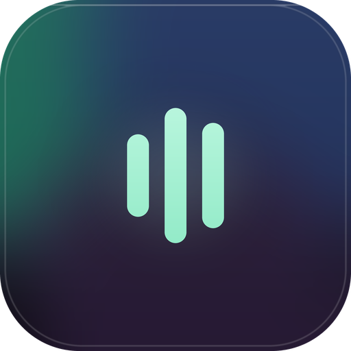
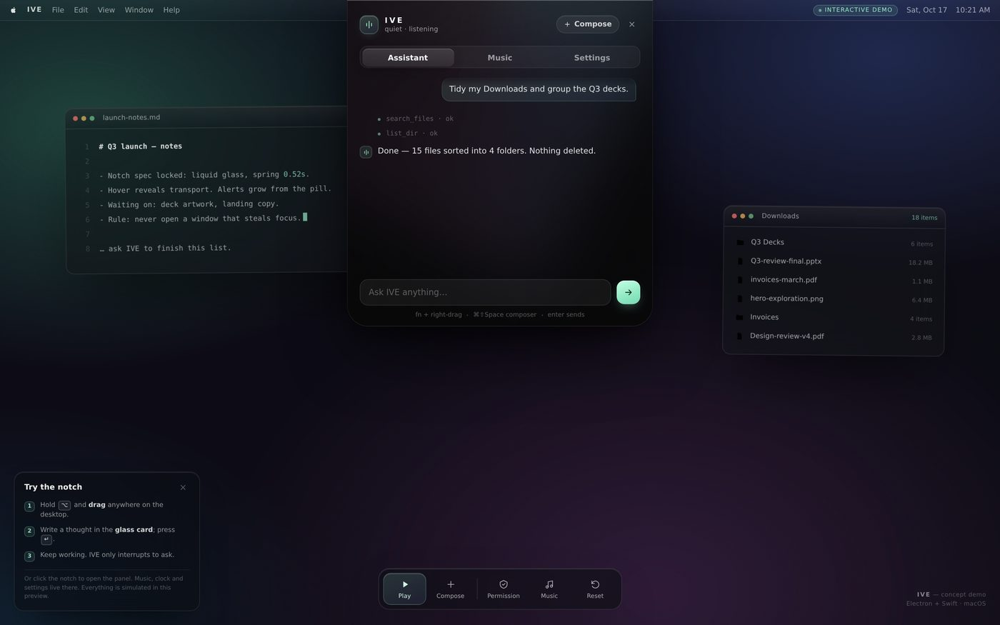
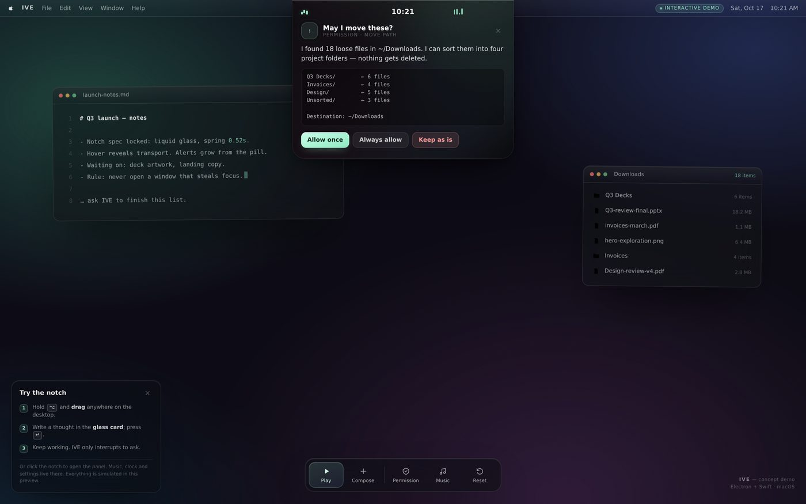
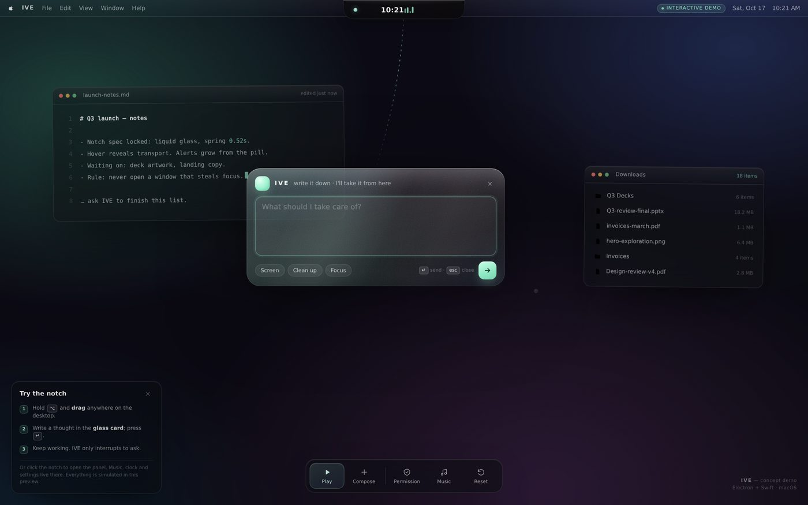
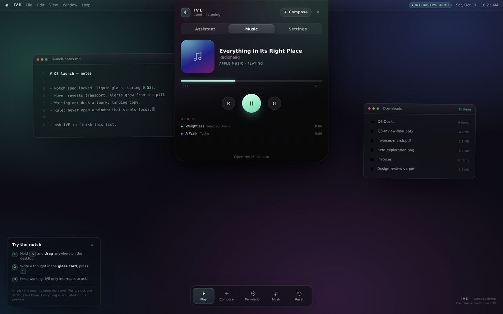
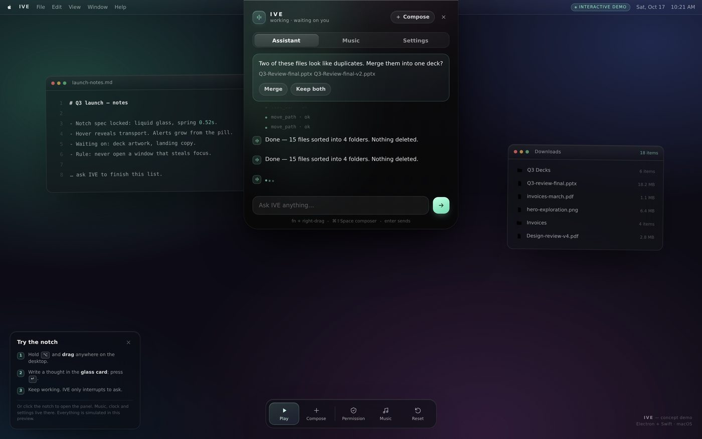
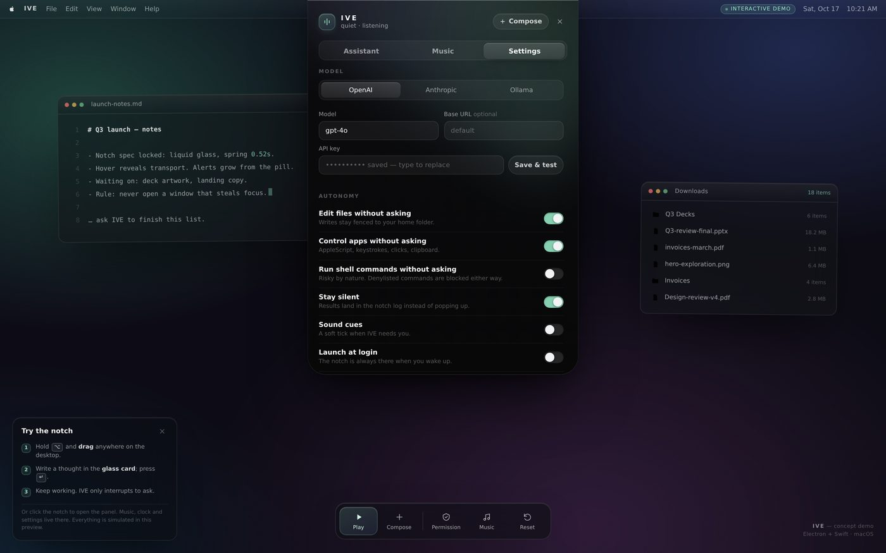

<div align="center">



# IVE

**A living notch for macOS.** Hold `fn`, drag, think out loud — the AI works in the background while you keep working.

[](demo/index.html)
[]()
[]()
[](LICENSE)










</div>

---

## What IVE is

IVE is not a chat window. It's a **notch** — a small black island that lives at the top of your screen, respects your focus, and only interrupts when it genuinely has to.

- **Summon it without leaving what you're doing.** Hold `fn` and right-drag anywhere on the screen. The selection melts into a **liquid glass composer**; type a thought, press `↵`, and the whole thing dissolves. Your app keeps its focus.
- **It works while you don't.** Prompts run through an agent loop in the background — reading and writing files, running commands, driving apps, looking at the screen. Results land quietly in the notch log.
- **It asks, minimally.** When IVE needs permission or a decision, the notch **grows smoothly** into a small card with real buttons. Answer it (or ignore it) and it shrinks back.
- **A notch that's worth glancing at.** Clock, now-playing with transport + queue, and a full settings panel — all inside the same shape, with spring physics and a slow aurora behind the glass.

Everything runs locally on your Mac. Your API key is stored encrypted with the OS keychain; there is no IVE cloud.

---

## Try the UI right now

The full interface is included as a **single-file, offline, interactive demo** — no install, no keys, nothing simulated in the cloud:

```
open demo/index.html
```

- Hold **⌥ (Option)** — the browser's stand-in for `fn` — and drag anywhere on the desktop to draw the glass composer.
- Click the notch to open the panel (Assistant / Music / Settings).
- `Play` in the dock runs the whole gesture for you, including a permission card.

The demo embeds the **actual renderer source** of the app, with a mock of the main process. Regenerate it after changing the UI with `npm run demo:build`. Browser interaction tests live in `test/demo/` (`npm run test:demo`).

---

## Install & run

**Requirements:** macOS 13+, Node 20+, Xcode Command Line Tools (`xcode-select --install`).

```bash
git clone <your-fork> ive && cd ive
npm install
npm run icons          # generates icon.png / trayTemplate.png
npm run build:fn       # compiles the Swift fn-listener helper
npm start
```

On first launch:

1. Click the notch → **Settings** → add a model key (OpenAI, Anthropic, or a local Ollama).
2. Grant **Accessibility** and **Input Monitoring** to IVE (needed for `fn` and for typing/clicking tools). Reopen IVE after granting.
3. Optionally grant **Screen Recording** — this powers the true glass behind the composer and the screenshot tool.

The `fn` helper is optional: without it, `⌘⇧Space` opens the composer at your cursor.

> Packages: `npm run dist` builds a signed-ready `.dmg` + `.zip` via electron-builder (arm64 + x64). CI does this for you on every tag — see [docs/ARCHITECTURE.md](docs/ARCHITECTURE.md#release).

---

## The gesture

```
        fn down ──┐
                  ▼
        right-drag ──► glass selection ──► card blooms open
                  │                          │  type
                  │                          ▼
        (context menu suppressed)          ↵ send
                                             │
                            the card exhales up into the notch
                                             │
                        you're back in your app, exactly where you were
```

- Under the hood a tiny Swift event tap (`native/fn-listener`) swallows right-clicks **only while `fn` is held**, so no context menu ever appears, and streams events to Electron.
- The overlay windows are click-through until the composer actually opens; the notch window is click-through except over the pill or an open panel, so the island never blocks your menu bar.

## The agent

- **Model-agnostic.** OpenAI-compatible (`gpt-*`), Anthropic (`claude-*`), or Ollama for fully local work. Custom base URLs are supported.
- **24 tools**: read/edit/write files, list & search, shell, AppleScript app control, keystrokes, clicks, clipboard, screenshots (vision), Shortcuts, music control, notifications, web fetch, and `ask_user` for decisions.
- **Permission model.** Reads, file edits, and app automation are allowed by default; shell commands ask unless you opt in. A denylist (sudo, `rm -rf /`, disk formatting, piping remote scripts into a shell…) is blocked even if approved. File writes are fenced to your home folder.
- **Stealth by design.** The agent never brings a window forward. While it works, the notch shows a small animated meter; when it finishes, the pill pulses once.

## Inside the notch

| | |
|---|---|
| **Assistant** | The quiet log: your prompts, tool activity, one-line results. Ask follow-ups inline. |
| **Music** | Apple Music & Spotify: artwork, scrubber, transport, up-next. Works from the pill on hover. |
| **Settings** | Provider + key, autonomy switches, permission states, reset, quit. |
| **Alerts** | Permission / question cards with buttons inside the notch body. |
| **Clock** | Always in the pill; tabular numerals, zero chrome. |

## Tests

```bash
npm test
```

Headless suites for the safety fences, both provider adapters (against local mock servers), the full agent loop including the permission round-trip, and module-load integrity.

## Documentation

- [docs/ARCHITECTURE.md](docs/ARCHITECTURE.md) — process model, event flow, gesture protocol, motion system
- [docs/PERMISSIONS.md](docs/PERMISSIONS.md) — every macOS permission, why, and how to reset it
- [CONTRIBUTING.md](CONTRIBUTING.md)

## Safety

IVE can genuinely act on your machine — that is the point. The rails are:

1. **Denylist** of catastrophic commands (`src/main/safety.js`) — cannot be approved away.
2. **Write fence** — file tools refuse paths outside `$HOME` and temp.
3. **Approval matrix** — shell and any tool you turn off require a click in the notch.
4. **Keys** are encrypted with `safeStorage` (Keychain) and never leave your machine except to the provider you chose.
5. **No telemetry.**

Read the code before trusting it with your files — `src/main/ai/tools.js` is where the hands are.

## Name

**IVE** — from *I've*. As in: *I've got it.*

## License

MIT — see [LICENSE](LICENSE).
